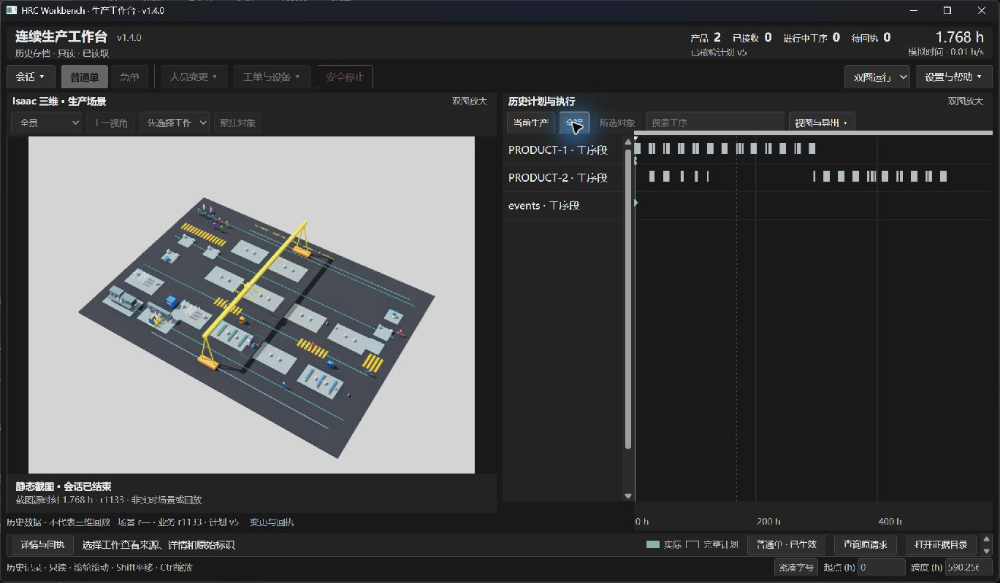
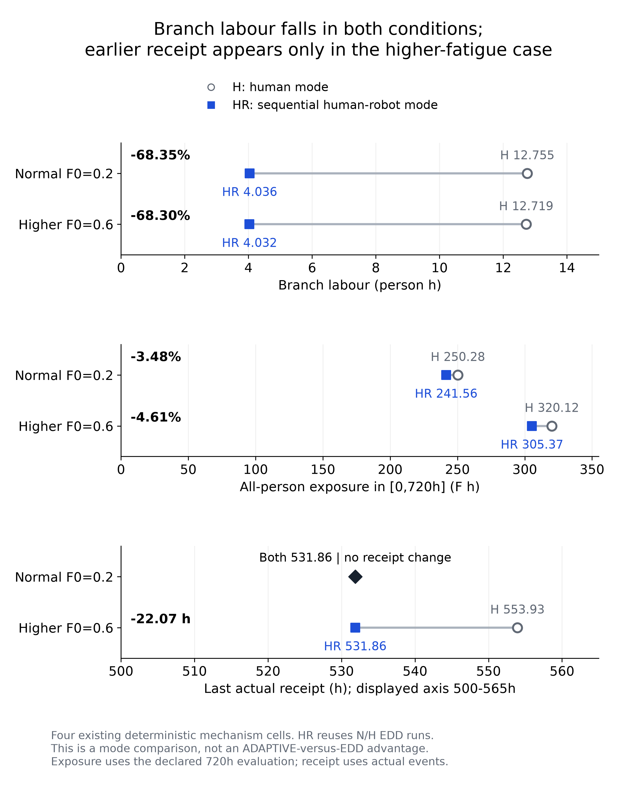
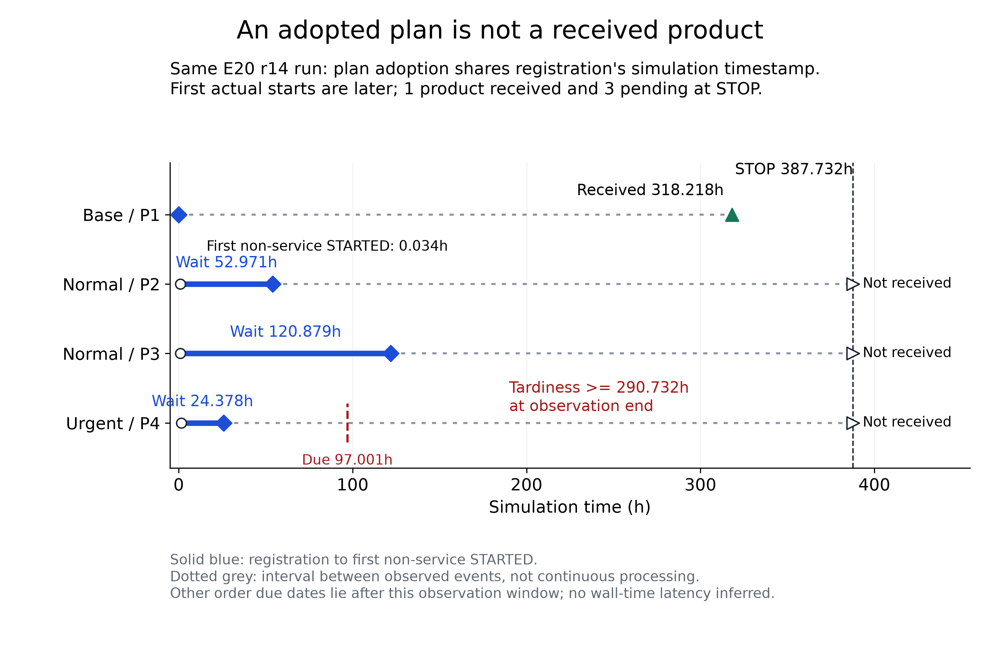
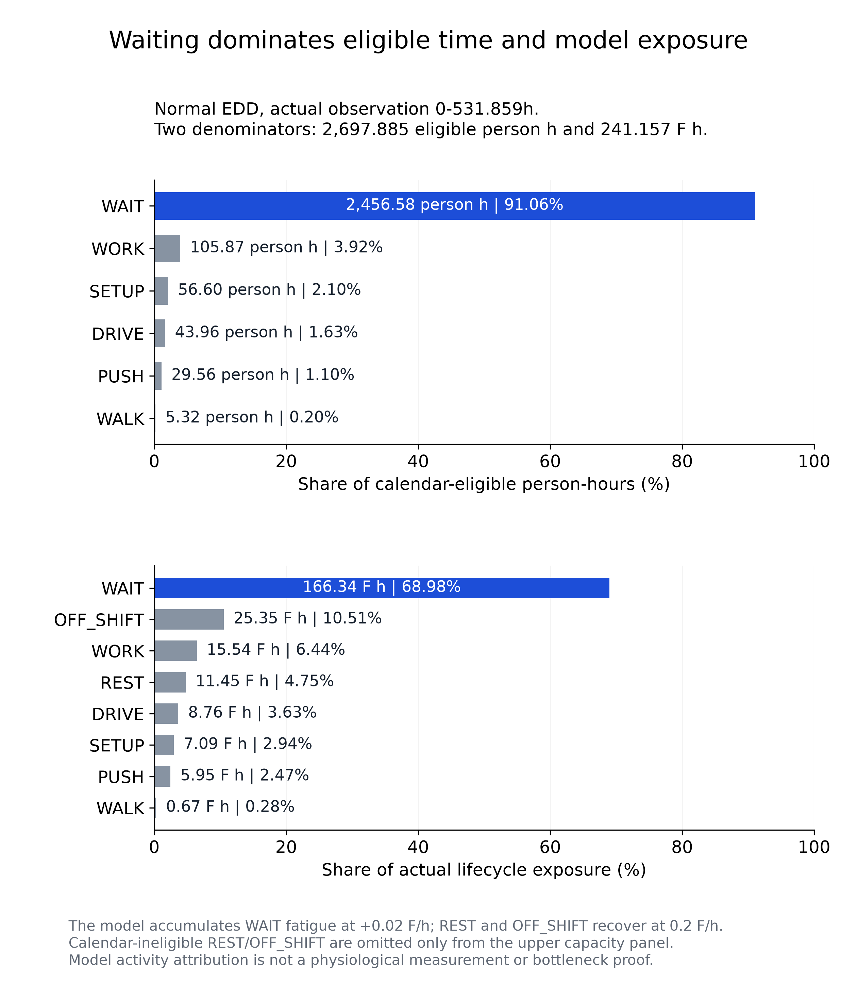
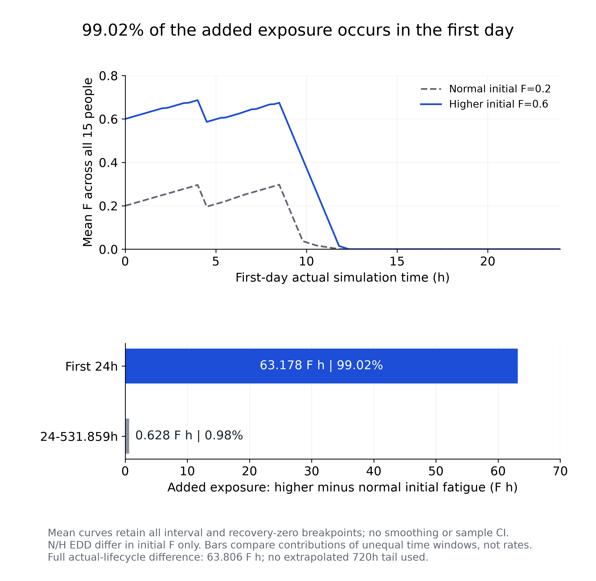

# 钢结构模块化建筑（MiC）车间人机协作动态排产与三维仿真系统

> **HKU CIVL7023 小组课程项目（`hku-courseproject-7023`）**  
> 一套面向钢结构“组装合成”建筑（MiC）预制车间的智能排班、突发改单重排与三维可视化仿真工作台。

---

## 一、这个项目到底在做什么？

现在盖楼越来越流行 **“组装合成”建筑法（MiC, Modular Integrated Construction）** —— 简单来说，就是不再把所有材料都拉到工地露天现浇，而是像造汽车、拼乐高一样，先在**工厂车间**里把一个个带钢结构框架的房间模块造好，再运到工地直接吊装拼接。

想法很美好，但**车间里的排产调度非常头疼**：
- **工序繁琐、环环相扣**：造好一个标准钢结构模块，要走完 **37 个工艺节点、400 多道具体工序**（下料切割、组对装夹、焊接、打磨、龙门吊翻身转运、质量检查等），前一道没干完或质检没放行，后一道就动不了。
- **人机混合作业，人还会累**：车间里有 **15 名不同工种资质的工人** 和 **10 台设备**（焊接机器人、切割机、龙门吊、搬运平板车、专用工装台等）。有些活只能人工干，有些活可以**人机协作**（工人负责装夹准备与收尾，机器人负责高强度焊接加工）。而且工人不是机器，连续干活甚至在现场干等都会积累疲劳，需要结合上下班日历和休息来恢复体力。
- **计划永远赶不上变化**：静态排班表排得再漂亮，遇到客户**中途插急单、改交期、临时退单**，或者车间**机器突然坏了要修、工人临时请假离岗**，整张排班表就会连锁瘫痪。

为了解决这些问题，我们小组开发了这套 **自适应人机协作排产与仿真系统（Adaptive HRC Scheduling）**。你可以把它理解成车间的 **“智能排班大脑 + 可视化数字沙盘”**：既能算排产计划、应对中途突发状况，又能把车间里谁在干什么、后续打算怎么干，直观地呈现在三维画面和甘特图上。

---

## 二、核心功能亮点

### 1. 把车间真实约束与“工人疲劳”算进排班表
系统把钢模块制造拆解为完整的工艺约束网络：谁有什么工种证、几点上下班、工装台够不够用、物料齐没齐套、龙门吊怎么走线，全都纳入校验。同时给每位工人建了“体力/疲劳账本”——干活和现场待命会消耗精力，休息和下班会自动回血，避免排出现实中根本干不动的“铁人计划”。

### 2. 遇到突发插单或故障，“不断片”安全重排
生产跑一半时，随时可以在系统里提交：
- **订单变动**：新增普通订单、插入加急订单、修改交期或优先级、取消订单；
- **车间异常**：设备故障停机与维修恢复、工人临时离岗请假与返岗。

重排时系统遵循严格的 **“在制品承诺保护”原则**：已经在半空吊运的构件、正在焊接的工序绝不强行打断，只对还没开始的后续任务重新排程，并通过独立防冲突核验后才真正下发执行。

### 3. 左看 3D 车间、右看甘特图的桌面工作台
我们基于 `PySide6 + React` 开发了桌面工作台，并支持接入 **NVIDIA Isaac Sim** 三维仿真引擎：
- **双屏实时联动**：左边看三维车间现场（支持用鼠标直接点选或框选吊车、工人、钢材，自动高亮对应的生产任务），右边看工序甘特图；
- **实绩与计划严格区分**：甘特图用不同样式清楚标明“已经干完的实际记录”和“接下来准备干的排产计划”，绝不把纸面计划混充实际完工；
- **无显卡也能用**：就算电脑没装 Isaac Sim 或没有独立显卡，也能直接用内置的 **纯 CPU 轻量模式** 跑完整个生产流程、查看甘特图、导出 PNG / PDF / CSV 报表，或者以只读模式打开历史运行存档复盘。



---

## 三、实验跑下来发现了什么？（核心研究结论）

我们围绕正常生产、高初始疲劳、设备故障、插急单、取消订单等典型场景跑了完整仿真实验，得出了几条很实在的结论：

### 1. 车间硬件产能卡死时，光靠“聪明重排算法”救不了交期
我们在 5 类固定场景下对比了传统的 **“谁交期急先做谁（EDD 规则）”** 和 **“在线自适应重排（ADAPTIVE 策略）”**。结果显示，两种方法下产品的最终实际完工时间几乎完全相同，而自适应搜索反而多花了不少计算时间（尤其在插急单场景下运行耗时增加了约 57%）。这说明当车间关键工位与设备本身已经满负荷运转时，瓶颈在硬件产能，单靠软件调换先后顺序无法凭空缩短总工期。

### 2. 上机器人能省下约 68% 的局部人力，但局部省时 ≠ 整单早交货
在适用工序上开启“人机接力协作模式（HR）”后，对应工序分支的人工工时直接减少了约 **68%**。但放到整张订单来看：如果工人本来精力充沛，最终交货时间并没有提前（因为其他非机器人环节还在排队等关键设备）；只有在工人初始疲劳较高的情况下，机器人顶上重活才让整单完工时间提前了约 **22 小时**。



### 3. 插急单确实能优先排上号，退单损耗也能一笔笔算清
在连续多订单动态测试中，普通新增订单登记后要排队 **53～121 小时** 才能真正干上第一道工序，而标记为“急单”的订单约 **24.4 小时** 就能优先开工（代价是其他老订单会被进一步往后挤）。当订单中途取消时，系统也能精确算出已经搭进去的沉没资源（例如退回钢材 3.318 吨，已消耗约 0.75 人工小时和 96.1 米搬运路程）。



### 4. 工人九成在岗时间其实花在“等前道工序衔接”
拆解常规排班下 15 名工人的时间账本可以发现，日历在岗可用时间里高达 **91%** 其实处于“现场待命等待（WAIT）”状态（等前道工序交接、等吊车、等质检放行），模型中约 **69%** 的疲劳累积也来自漫长的现场耗等。另外，如果工人第一天带着较高初始疲劳上岗，多出来的疲劳负担有 **99%** 都集中在头 24 小时内，熬过第一个夜间休息后基本就能缓过来。





---

## 四、项目报告与资料速查（不用配环境也能直接看）

如果你只是想了解我们的完整建模细节、算法设计或直接阅读项目报告，可以直接点开仓库里整理好的文件：

- **中文完整项目报告（最新版 PDF）**：[`reports/v1.4.0/report-mic-zh_v1.4.0.pdf`](reports/v1.4.0/report-mic-zh_v1.4.0.pdf)（同目录附带 Word `.docx` 版）
- **英文完整项目报告（最新版 PDF）**：[`reports/v1.4.0/report-mic-en_v1.4.0.pdf`](reports/v1.4.0/report-mic-en_v1.4.0.pdf)
- **初版评审定稿报告（中 / 英 PDF）**：[`reports/final/report-mic-zh_reviewed.pdf`](reports/final/report-mic-zh_reviewed.pdf) · [`reports/final/report-mic-en_reviewed.pdf`](reports/final/report-mic-en_reviewed.pdf)
- **实验数据与图表逐项说明**：[`docs/public_results/README.md`](docs/public_results/README.md)
- **桌面工作台操作说明**：[`docs/releases/v1.4.0-user-guide.zh-CN.md`](docs/releases/v1.4.0-user-guide.zh-CN.md)

---

## 五、快速上手：怎么在本地跑起来？

本项目基于 **Python `3.12.13`** 和包管理工具 **`uv`（`0.12.3`）**。下面按从简到繁提供三种运行方式（以 Windows PowerShell 为例）：

### 方式 1：只重算实验数据并生成图表（最快，无需显卡 / 无需装 3D 引擎）
直接基于仓库里保存好的实验记录，一键重新生成全部统计 CSV 表格和论文配图：

```powershell
git clone https://github.com/kunnnn666/hku-courseproject-7023.git
cd hku-courseproject-7023
uv python install 3.12.13
uv venv --python 3.12.13 .local/results-env
uv pip install --python .local/results-env/Scripts/python.exe -r analysis/p07/requirements.txt
& .local/results-env/Scripts/python.exe analysis/p07/presentation.py replay --output .local/results-demo
```

跑完后打开 `.local/results-demo` 文件夹，就能看到重新生成的 9 张统计表（`presentation/`）和 4 幅图表（`figures/`）。

### 方式 2：在命令行跑一次完整的纯 CPU 车间排产模拟
不需要图形界面，直接在后台跑通一整套单产品正常生产流程并做自动审计：

```powershell
uv sync --locked --link-mode copy
uv run --locked python scripts/verify_production_chain.py --output .local/new-normal-cpu --backend light --simulation --products 1 --variant SR-W1 --scenario NORMAL --until-h 720
```

### 方式 3：启动桌面可视化工作台（Qt + 网页甘特图）
想打开可视化操作界面体验排产、改单和甘特图浏览（需本机安装 Node.js 用于首次构建前端页面）：

```powershell
uv sync --locked --link-mode copy
uv sync --locked --project desktop/p051
npm.cmd --prefix desktop/p051/web ci
npm.cmd --prefix desktop/p051/web run build
& ./desktop/p051/.venv/Scripts/python.exe ./scripts/run_p051_workbench.py
```

> **提示**：默认在工作台里选择 **CPU 数据模式** 或打开只读示例即可直接体验；如果要在左侧窗口运行实时三维物理仿真，需要本机额外安装 **NVIDIA Isaac Sim 6.1** 和 **PowerShell 7**，并在工作台设置里指定 Isaac 安装目录及纯英文输出路径（如 `C:\HRC\runs`）。

### 运行单元测试检查
如果你想验证代码库完整性，可以运行项目自带的检查脚本（包含代码规范与 1,300+ 项单元测试）：

```powershell
uv run --locked python scripts/check.py
```

---

## 六、仓库目录结构一览

仓库文件比较多，按下面这张清单找文件最省事：

```text
hku-courseproject-7023/
├── reports/                     # 项目完整报告（中英文 PDF、Word 原稿及报告生成脚本）
├── src/adaptive_hrc_scheduling/ # 核心算法库（车间工艺模型、疲劳计算、排产求解与动态控制）
├── desktop/                     # 桌面可视化工作台（PySide6 桌面端 + React 甘特图前端）
├── sim/                         # NVIDIA Isaac Sim 三维车间场景搭建与状态同步模块
├── analysis/                    # 实验结果离线统计、数据复核与图表生成脚本
├── figures/                     # 整理好的实验对比图（PNG / SVG / PDF）
├── results/                     # 已归档的仿真实验输出数据与甘特导出记录
├── examples/                    # 预设测试场景与实验复现输入包
├── experiments/                 # 实验批次参数配置与清单
├── scripts/                     # 常用命令行启动入口、仿真运行与审计脚本
├── tools/                       # 桌面端打包、启动自检排错与发布辅助工具
├── schemas/                     # 数据结构与接口 JSON Schema 定义
├── docs/                        # 建模规范、算法说明、操作指南与开发验证归档
└── tests/                       # 自动化单元测试集
```

---

## 七、目前还存在的不足（已知局限）

作为课程研究与原型系统，目前还有几个坦诚记录的短板，也是后续可以继续打磨的方向：
1. **重排速度还不够快**：遇到复杂插单或故障时，后台重新搜索排班并跑完一整套防冲突校验大约要花 1.5～4 分钟，还做不到车间秒级无感响应。
2. **暂不支持手动点名休息**：目前工人什么时候休息由排班逻辑按规则自动安排，界面上还没开放“手动点按钮强制让某位工人去休息”的功能。
3. **在制品退单清场仍待细化**：订单做到一半被取消时，现场半成品和工位的后续清理流程目前还是简化处理。
4. **3D 模式对环境要求高**：实时三维画面依赖本地安装 NVIDIA Isaac Sim 6.1 及对应显卡环境，普通轻薄本建议直接使用纯 CPU 模式或只读存档查看功能。

---

## 八、开源许可

本项目源代码采用 [MIT License](LICENSE) 开源许可。
